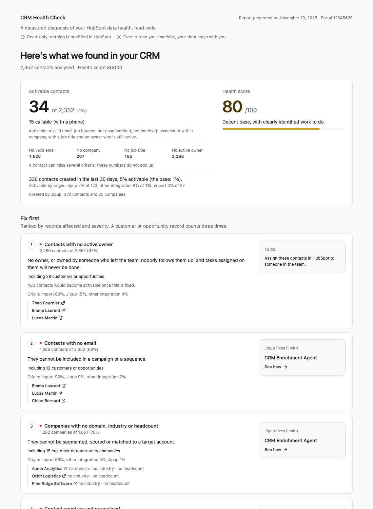

# CRM Health Check

A **read-only** audit of your HubSpot CRM that runs **on your machine**, inside
a tool you already use (Claude Code / Claude Desktop). No signup, no data sent
to any third party.

- 🔒 **Your data never leaves your machine.** The script talks only to
  `api.hubapi.com` and only performs read requests. [Read the code](skill/scripts/crm-audit.mjs) —
  it's one file.
- 🎯 **Deterministic scoring.** The report is computed by code, not by an LLM:
  9 pillars (duplicates, completeness, quality, structure, freshness,
  staleness, deliverability, pipeline hygiene, schema debt), a 0–100 score,
  a waste estimate in euros, and a record-by-record remediation plan.
- 🗑️ **Revocable in one click.** The audit uses a HubSpot private app token you
  create with read-only scopes and can delete right after.



## Quick start (as a Claude skill)

1. Install the skill:

   ```bash
   npx skills add Jipup/crm-health-check
   ```

   Or manually:

   ```bash
   git clone https://github.com/Jipup/crm-health-check.git
   cp -r crm-health-check/skill ~/.claude/skills/crm-health-check
   ```

2. In Claude Code (or Claude Desktop), say: **"Audit my HubSpot CRM"**.

3. Claude walks you through creating a read-only HubSpot token (~3 minutes),
   runs the audit, and opens the report dashboard in your browser — in your
   language (English or French).

## Quick start (script only, no Claude)

Requires Node.js >= 18. Create a HubSpot private app
(Settings → Integrations → Private Apps) with these read-only scopes —
required: `crm.objects.contacts.read`, `crm.objects.companies.read`;
recommended: `crm.objects.deals.read`, `crm.objects.owners.read`,
`crm.schemas.contacts.read`, `crm.schemas.companies.read`,
`crm.schemas.deals.read` — then:

```bash
HUBSPOT_TOKEN=pat-xx-xxxx node skill/scripts/crm-audit.mjs --out crm-audit-report.json
```

The console prints a summary; the JSON file holds the full report and sample
evidence with deep links into your portal.

## What the audit checks

| Pillar | What it measures |
| --- | --- |
| Duplicates | Contacts & companies appearing more than once |
| Completeness | Missing emails, phones, job titles, LinkedIn URLs… |
| Quality | Malformed values, inconsistent domains/names |
| Structure | Records without owners, ownerless distribution |
| Freshness | How recently records were touched |
| Staleness | Contacts likely obsolete (job changes) |
| Deliverability | Hard bounces, unsubscribed share, ghost contacts (10+ marketing emails, never opened), marketing contacts billed but unreachable |
| Pipeline | Zombie deals, stage hygiene |
| Schema debt | Ghost custom properties nobody fills |

Pillars whose scope you didn't grant are reported as **"not analysed"** —
never silently counted as perfect.

## About the code you're reading

`skill/scripts/crm-audit.mjs` is the exact, un-minified, readable build that
runs on your machine — audit it yourself: it talks only to `api.hubapi.com`
and only performs read requests. The engine's TypeScript source lives in
Jipup's product codebase (it is the same engine that powers the connected
audit inside the product, `AuditReport.version` keeps the two in lockstep);
this repo ships the build, regenerated from that source on every release.

---

Built by [Jipup](https://jipup.com) — AI agents that keep your CRM clean,
enriched, and up to date automatically.
